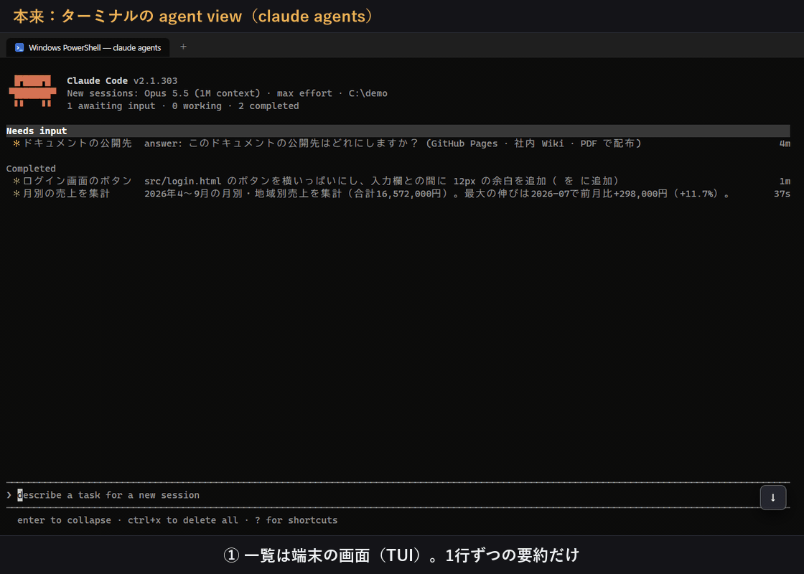

# Agent View Chat

[日本語](README.md) | English

A Windows app for viewing and replying to Claude Code background sessions (`claude --bg`) in a chat UI, instead of the terminal.

Also available as a free skill on Agensi: https://www.agensi.io/skills/agentview-chat



You can already watch and reply to background sessions from the terminal agent view (`claude agents`). But it is a terminal screen: the list is one-line summaries, and reading a conversation or answering it means keyboard work. I built this to do the same thing in a **chat UI**. Conversations read like a normal chat, with tables and code blocks rendered properly. Questions can be answered by clicking an option, and replies are just typed into a box and sent.

It is meant for sessions you launch in the background — for example from Task Scheduler with `claude --bg` — and only open when something catches your eye. Only background sessions appear in the list; conversations you are having interactively in a terminal do not.

## Requirements

Node.js 20 or later and Claude Code. The `claude` command must be available and logged in. Developed and used on Windows 11, Node.js 22, Claude Code 2.1.305.

## Starting it

Clone this repository and run `start.cmd`. The first run installs dependencies and takes a minute or two. After a `git pull`, run `npm ci` once before starting.

A server starts on `127.0.0.1:4790` and opens in a window without an address bar if Chrome is available, otherwise in your default browser. The background sessions are run by the Claude Code daemon, so closing the window or the server does not stop them. The server can be stopped from "About this app" in Settings.

## Using it

The list on the left groups background sessions into Waiting / Working / Error / Finished / Recent. "Finished" means ended and not yet viewed; opening one moves it to "Recent". While any session is waiting for input, the window title shows the count.

Hovering over a row shows the last reply or the pending question. Questions can be answered right there by clicking an option. Clicking a session opens the conversation, and you reply from the box at the bottom. A reply sent to a working session is delivered after its current work finishes. To interrupt immediately, use Ctrl+Shift+Enter — that stops the work first, then sends.

Start a new background session with Ctrl+Shift+O. Give it a folder and a task, and it launches with `claude --bg`; the same session also appears in the terminal agent view. You can choose the model, effort, and permission mode.

Tool permissions and plan approvals cannot be answered from this screen. Use "Open in terminal" in the header, which opens `claude attach` in Windows Terminal, and answer there. The header's "…" menu offers `claude stop` and `claude rm`.

Press Ctrl+K to search background sessions by name, folder, or content. Key bindings can be changed in Settings (Ctrl+,) under "Key operations".

## How replies work

Replies are sent using official commands only: `claude stop` to stop the session, then `claude --bg --resume <session ID> -- <reply>` to resume it with the same ID. That is why there are a few seconds of lag between sending and the session moving again. No keystrokes are injected and nothing writes directly to the daemon. The session list is read with `claude agents --json --all`, and conversations via the Agent SDK's `getSessionMessages`.

Claude Code decides a session's state from the content of its last reply, so a session that ends with a message like "I'll proceed with…" can stay shown as "working" after it has actually stopped. This app treats a stopped session whose last message is from Claude as "Finished".

## Launching from Task Scheduler

Sessions started by scripts with `claude --bg` appear in the list as-is. `claude --bg` returns as soon as the session starts, so the task itself finishes immediately. Naming sessions with `-n` makes them easier to tell apart in the list (`claude --bg -n "morning report" -- "…"`).

Run the task as your own user, with "Run only when user is logged on". If you choose "Run whether user is logged on or not", the daemon may start in a separate session from your desktop, and then neither this app nor the terminal agent view can reach it. While that lasts, `claude --bg` run by hand will also fail.

If "Start in (optional)" is empty, the script runs in `C:\Windows\System32`, and Claude starts working there too. Set the working folder, or change directory inside the script before calling it.

Running a PowerShell script directly from a task opens a console window on every run. If you don't want the window, launch it from a windowless program such as `pythonw.exe` with CREATE_NO_WINDOW:

```python
# launch.pyw (set the task action to: pythonw.exe launch.pyw)
import subprocess
subprocess.run(['powershell.exe', '-NoProfile', '-ExecutionPolicy', 'Bypass', '-File', r'C:\path\to\script.ps1'],
               creationflags=subprocess.CREATE_NO_WINDOW)
```

For unattended runs, set `--permission-mode` or your allowed-tools configuration so that no confirmation prompts appear. If a session stops at a prompt, it will not move until you answer in a terminal. Questions asked via AskUserQuestion, on the other hand, can be answered from this app.

## Settings and data

In Settings you can change the defaults for new background sessions (folder, model, permissions, effort), desktop notifications, key bindings, and appearance. Notifications only appear while the window is open.

When a new Claude Code release is available, the app tells you at startup and on a check every 3 hours. Pressing "Update" runs `claude update`. Running background sessions are left as they are, and use the new version from their next reply onward. Automatic updates can also be enabled.

Unread state, queued replies, and settings are stored in the `data` folder. The conversations themselves live in Claude Code's `~/.claude`, and this app only reads them. To uninstall, stop the server and delete this folder.

## Tests

Tests for the parts that don't show on screen — conversions in `lib/`, version comparisons, and similar — live in `test/`. Run them with `npm test` (uses Node's built-in test runner, so no extra packages are needed).

## License

[MIT](LICENSE)
