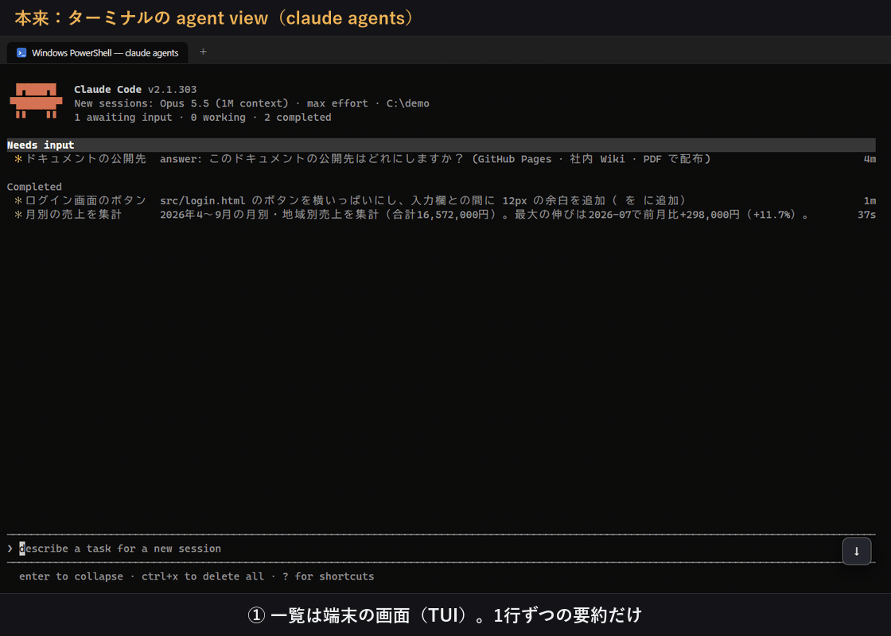

# Agent View Chat

`claude --bg` で動かしている Claude Code の裏セッション（バックグラウンドセッション）を、チャット画面で見たり返信したりするための Windows 用アプリです。



裏セッションは、ふつうはターミナルの agent view（`claude agents`）からしか操作できません。タスクスケジューラから `claude --bg` で動かしておいて、気になったときだけ様子を見たり指示を足したりしたかったので作りました。一覧に出るのは裏セッションだけで、ターミナルで対話している会話は出ません。

## 必要なもの

Node.js 20 以降と Claude Code が要ります。`claude` コマンドが使えて、ログインできている状態にしておいてください。Windows 11、Node.js 22、Claude Code 2.1.305 で動かしています。

## 起動

リポジトリを clone して `start.cmd` を実行します。初回は依存パッケージを入れるので 1〜2 分かかります。`git pull` で更新したときは、`npm ci` を一度実行してから起動してください。

サーバーが 127.0.0.1:4790 で起動し、Chrome があればアドレスバーのない窓で、なければ既定のブラウザで開きます。裏セッションを動かしているのは Claude Code の daemon なので、窓やサーバーを閉じても裏セッションは止まりません。サーバーは設定の「このアプリについて」から止められます。

## 使い方

左の一覧に、裏セッションが入力待ち・作業中・エラー・完了・最近に分かれて並びます。完了は終わってまだ見ていないもので、開くと「最近」に移ります。入力待ちがあるあいだは、窓のタイトルに件数が出ます。

行にマウスを乗せると、最後の返事や待っている質問が出ます。質問にはその場で選択肢を押して答えられます。クリックすると会話が開いて、下の欄から返信できます。作業中のセッションに送った返信は、今の作業が終わってから届きます。すぐ割り込みたいときは Ctrl+Shift+Enter で、作業を止めてから送ります。

新しい裏セッションは Ctrl+Shift+O で始めます。フォルダと頼みたいことを書くと `claude --bg` で起動し、ターミナルの agent view にも同じものが出ます。モデル、effort、権限モードも選べます。

ツールの許可やプランの承認には、この画面からは答えられません。見出しの「ターミナルで開く」で Windows Terminal に `claude attach` が開くので、そちらで答えてください。見出しの「…」からは `claude stop` と `claude rm` が使えます。

Ctrl+K で裏セッションを名前・フォルダ・中身から探せます。キーの割り当ては設定（Ctrl+,）の「キー操作」で変えられます。

## 返信のしくみ

返信は公式のコマンドだけで送っています。`claude stop` でいったん止めてから、`claude --bg --resume <セッション ID> -- <返信>` で同じ ID のまま再開するので、送ってから動き出すまで数秒かかります。キー入力を送り込んだり、daemon に直接書き込んだりはしていません。一覧は `claude agents --json --all`、会話は Agent SDK の `getSessionMessages` で読んでいます。

Claude Code は最後の返事の中身で状態を決めるので、「〜で進めます」のような文で終わると、止まっていても「作業中」のまま残ることがあります。このアプリでは、止まっていて最後が Claude の返事なら「完了」として出しています。

## タスクスケジューラから起動するとき

スクリプトから `claude --bg` で起動したセッションも、そのまま一覧に出ます。`claude --bg` はセッションを始めるとすぐ戻るので、タスク自体はすぐ終わります。`-n` で名前を付けておくと、一覧で見分けやすくなります（`claude --bg -n "毎朝のレポート" -- "…"`）。

タスクは自分のユーザーで、「ユーザーがログオンしているときのみ実行する」にしてください。「ログオンしているかどうかにかかわらず実行する」にすると、daemon がデスクトップとは別のセッションで起動することがあり、そうなるとこのアプリからもターミナルの agent view からもつながりません。そのあいだは、手元で実行した `claude --bg` も失敗します。

「開始（オプション）」が空だと、スクリプトは `C:\Windows\System32` で動き、Claude もそこで作業を始めます。作業フォルダを指定しておくか、スクリプトの中で移動してから呼んでください。

PowerShell のスクリプトをタスクから直接動かすと、実行のたびにコンソール窓が開きます。窓を出したくないときは、`pythonw.exe` のような窓を持たないプログラムから CREATE_NO_WINDOW で起動します。

```python
# launch.pyw（タスクの操作は pythonw.exe launch.pyw）
import subprocess
subprocess.run(['powershell.exe', '-NoProfile', '-ExecutionPolicy', 'Bypass', '-File', r'C:\path\to\script.ps1'],
               creationflags=subprocess.CREATE_NO_WINDOW)
```

人がいないときに動かすなら、`--permission-mode` や許可するツールの設定で、確認が出ないようにしておいてください。確認で止まると、ターミナルで答えるまで先に進みません。AskUserQuestion の質問なら、このアプリから答えられます。

## 設定とデータ

設定では、新しい裏セッションの既定（フォルダ・モデル・権限・effort）、デスクトップ通知、キー操作、見た目を変えられます。通知が出るのは窓を開いているあいだだけです。

新しい Claude Code が出ると、起動時と 3 時間おきの確認で知らせます。「更新する」を押すと `claude update` を実行します。動いている裏セッションはそのままで、次に返信したときから新しい版で動きます。自動で更新するようにもできます。

未読や送る予定の返信、設定は `data` フォルダに保存しています。会話そのものは Claude Code の `~/.claude` にあり、このアプリは読むだけです。アンインストールは、サーバーを止めてからこのフォルダを消すだけです。

## ライセンス

[MIT](LICENSE)
